# Learnit Anki architecture

Learnit turns text, images, and audio into study cards. The macOS app is a SwiftUI front end for a local SQLite collection and a separate Anki export window. It runs Python commands from the selected project checkout. Capture, enrichment, saving, and review are separate operations, so the user can correct a transcription or reading before it becomes card data.

For installation and controls, see the [user guide](docs/japanese_card_intake.md). For the intake design and its acceptance criteria, see the [Japanese card intake spec](docs/specs/japanese-card-intake.md).

- [Runtime and component boundaries](#runtime-and-component-boundaries)
- [Capture a passage](#capture-a-passage)
- [Add reading, meaning, and pronunciation](#add-reading-meaning-and-pronunciation)
- [Save in Learnit or export to Anki](#save-in-learnit-or-export-to-anki)
- [Import an existing Anki collection](#import-an-existing-anki-collection)
- [Collection data and presentation](#collection-data-and-presentation)
- [Review a deck](#review-a-deck)
- [Search and edit cards](#search-and-edit-cards)
- [Maintain the study collection](#maintain-the-study-collection)
- [Recognition evaluation](#recognition-evaluation)
- [Server-side code in the repository](#server-side-code-in-the-repository)

## Runtime and component boundaries

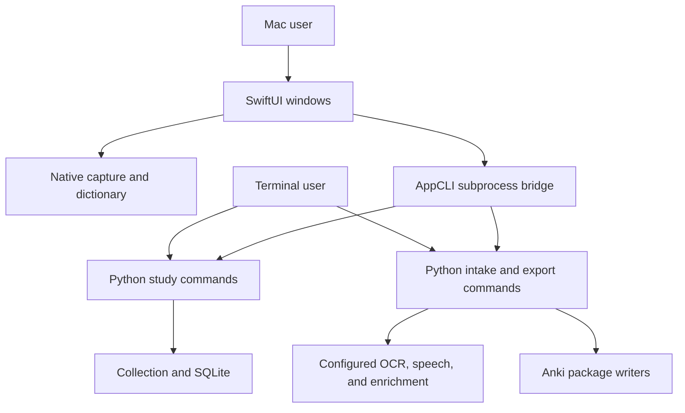

| Component | Responsibility | Source |
| --- | --- | --- |
| App entry and project settings | Open the study workspace and the separate Anki Export window. Persist the selected checkout in macOS user defaults. | [App entry](learnit-deck/learnit-deck/learnit_deckApp.swift), [project settings](learnit-deck/learnit-deck/ContentView.swift) |
| Study workspace | Own sidebar navigation and coordinate import, backups, and maintenance. | [StudyWorkspace](learnit-deck/learnit-deck/StudyWorkspace.swift) |
| Collection client | Decode command replies into Swift types, publish collection summaries, and signal changes to open views. | [StudyLibrary](learnit-deck/learnit-deck/StudyLibrary.swift) |
| Card workspace | Manage media, draft text, enrichment controls, preview, and the save destination. Both macOS windows use this editor. | [MediaCardView](learnit-deck/learnit-deck/MediaCardView.swift), [PassagePreview](learnit-deck/learnit-deck/PassageCard.swift) |
| Subprocess bridge | Run the checkout's `.venv/bin/python` with the project as its working directory. Decode JSON results and turn command failures into UI errors. | [AppCLI](learnit-deck/learnit-deck/AppCLI.swift) |
| Python entry points | Run intake and export through `infrastructure/cli/main.py` and collection operations through `python -m infrastructure.cli.study`. The main CLI also exposes the `study` command group. | [Main CLI](infrastructure/cli/main.py), [study CLI](infrastructure/cli/study.py) |
| Service configuration | Read settings from the environment and the project's `.env`. Construct the provider adapters for transcription and standard card generation. | [Settings](infrastructure/config/settings.py), [ServiceContainer](infrastructure/config/dependency_injection.py) |

The Mac bridge launches a process per command. SwiftUI keeps the interactive draft and selection state in memory. Python owns collection transactions and provider calls. The two sides exchange arguments, selected files or temporary draft files, and JSON replies. `AppCLI` reads the last line it can decode as the requested result, allowing commands to emit diagnostic output. Study operations call the study CLI module directly and use the local database without bootstrapping cloud providers.

### Where users enter the workflows

| Screen or command | User action | Main component |
| --- | --- | --- |
| **Today**, **Decks**, **Progress** | See due cards and activity, create a deck, or start a review. | `StudyWorkspace`, [deck and progress views](learnit-deck/learnit-deck/StudyDecksPage.swift), `Collection.summary` |
| **Create** | Type a passage, capture it from media, add reading or meaning, and save a card. | `MediaCardView`, `PassagePreview`, `study save` |
| **Review** | Reveal the answer and rate the card. | [StudyReviewPage](learnit-deck/learnit-deck/StudyReviewPage.swift), `study next-card`, `study grade` |
| **Browse** | Search, inspect, edit, or move study cards. | [StudyBrowsePage](learnit-deck/learnit-deck/StudyBrowsePage.swift), `study browse`, `study card`, `study edit` |
| **Today** or sidebar **Settings** | Preview and import an existing Anki deck. | `StudyWorkspace`, `study preview-import`, `study import` |
| Sidebar **Settings** | Set study preferences, back up or restore the collection, or clean up older readings. | `StudyWorkspace` and the study command group |
| **File → Anki Export Window** | Write a passage card for an existing Anki note type, or use standard single or batch export. | `MediaCardView`, `export-passage`, `add`, `batch` |
| **Learnit → Settings** | Change the checkout used for Python or run the setup check. | `ProjectSettingsView`, main CLI `test` |

## Capture a passage

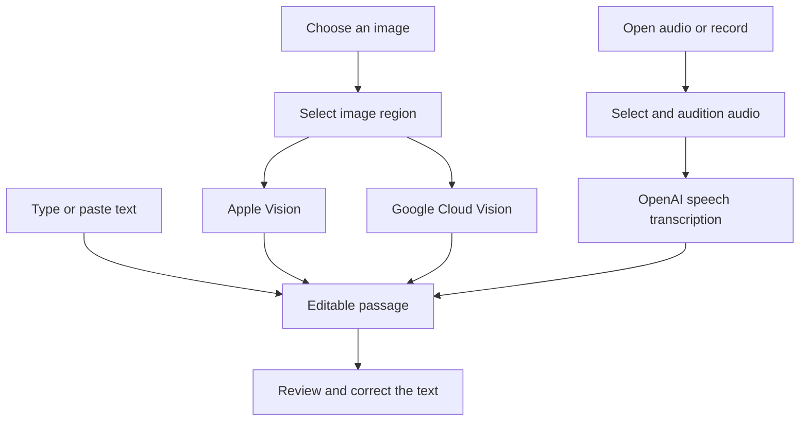

- [ImageOCR](learnit-deck/learnit-deck/ImageOCR.swift) runs **Recognize on Mac** with Apple Vision using Japanese recognition. For **Use Google instead**, Swift prepares the selected crop as PNG or a smaller high-quality JPEG and passes the file to `ocr`. [GoogleVisionTranscriber](adapters/transcription/google_vision.py) requests document text detection and checks upload size before submitting it.
- [AudioClip](learnit-deck/learnit-deck/AudioClip.swift) validates the requested start and end times. Swift auditions the selection and exports a temporary WAV when transcription is limited to an excerpt. AVFoundation handles native processing. FFmpeg handles formats it can decode when needed, with an AVFoundation fallback when the source can be read. A full-file transcription sends the original file. The last successful transcription provides the source label and optional time range for the draft.
- `ocr` and `transcribe` construct [TranscribeMediaUseCase](core/use_cases/transcribe_media.py) with a provider that fulfills `TranscriptionService` from the [domain interfaces](core/domain/interfaces.py). The use case returns `CardDraft(text, language, source)`. The Mac editor reads the text from that reply and retains its own source and clip state. Manual input and native OCR fill the same editor without a Python transcription call.
- Recognition results are editable text. Temporary crop and excerpt files produced for recognition are removed when the operation finishes. An empty result or a provider failure returns control to the editor with a status message.

## Add reading, meaning, and pronunciation

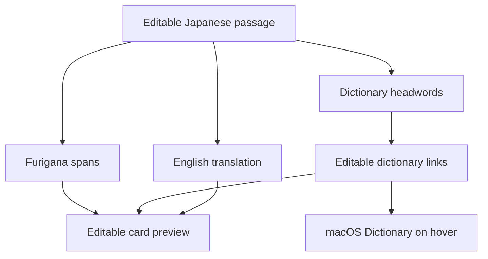

| User action | Component and contract |
| --- | --- |
| Open **Furigana** or preview the card | [FuriganaDraft](learnit-deck/learnit-deck/Furigana.swift) calls `furigana`. The [MeCab adapter](adapters/readings/mecab.py) uses fugashi and UniDic to return original text spans, optional readings, and editability flags. The editor supports corrections and adjacent kanji joins. It can offer manual spans when analysis fails. Approved readings are serialized in Anki bracket notation. |
| Click **Look up words** | `dictionary-headwords` calls the [headword extractor](adapters/dictionary/japanese_headwords.py). It uses the sentence's tokenization, grammatical categories, and dictionary forms to suggest editable headwords. This filters common particles and auxiliary forms and turns inflected forms such as 置いて into 置く. |
| Hover or click a dictionary link | [JapaneseDictionary](learnit-deck/learnit-deck/JapaneseDictionary.swift) requests a definition from the enabled macOS dictionaries when the hover popover opens. Clicking a link opens Dictionary. [Dictionary pointers](adapters/dictionary/pointers.py) stores the links as `dict://` anchors in `Meaning`. Text entered in **Definition notes** is stored with the card. |
| Click **Translate** or type an English translation | `translate-passage` uses the configured translation service for Japanese to English and returns text to the editor. The user can supply or edit a translation in SwiftUI. |
| Enable pronunciation or include source audio | At save or export, the passage workflow uses macOS `say` with the Kyoko voice for pronunciation. It can also attach the original recording or the chosen excerpt. These options produce separate media attachments. |

`PassageDraft` is the approval payload. It contains the expression, dictionary headwords, definition notes, source, context, translation, and the approved reading. A passage needs text and at least one dictionary link, definition, context note, or translation. The cited source and media accompany those fields when supplied.

## Save in Learnit or export to Anki

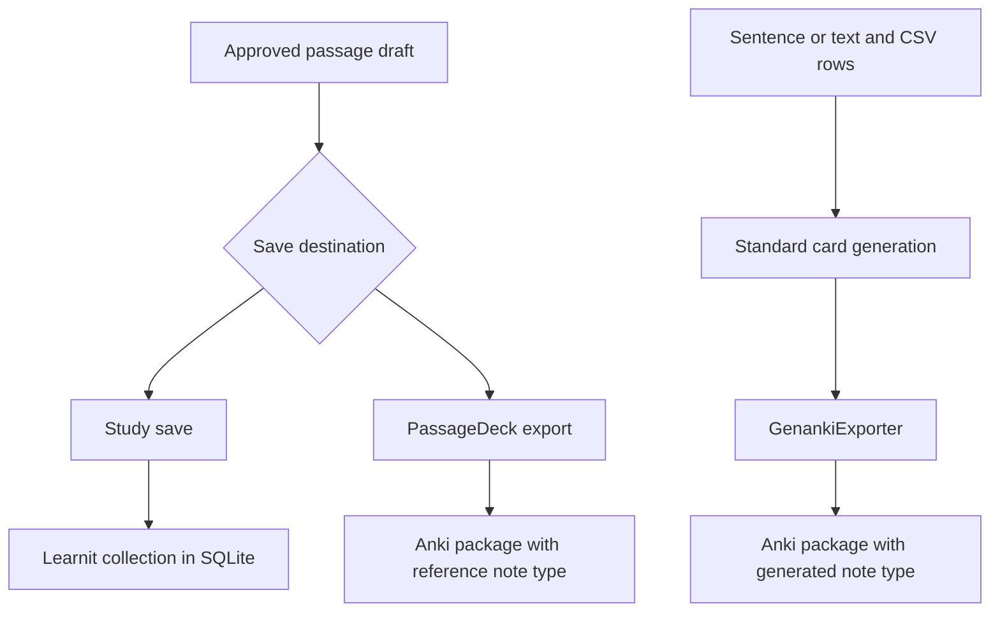

| Destination | Components | Result |
| --- | --- | --- |
| **Save card** in the study workspace | Swift serializes `PassageDraft` into a temporary JSON file and passes it, a deck ID, and optional audio paths to `study save`. [Collection.save_card](adapters/study/collection.py) writes the note, a new card, and media in one transaction. | The card is available for review and search in Learnit. A successful save clears the draft and refreshes the collection summary. |
| **Export to Anki** with a reference deck | `passage-deck` inspects the reference and `export-passage` calls [PassageDeck](adapters/anki/passage_deck.py). It reads the reference `collection.anki2` database in read-only mode and matches one non-filtered deck and single-template note type with the fields `Expression`, `Meaning`, and `Reading` in that order. | A separate `output/learnit-passage-<hash>.apkg` with the original model ID, deck ID, and template. The card's audio is embedded and linked from `Meaning` when selected. |
| **Use standard card format** or run `add` / `batch` | [GenerateCardUseCase](core/use_cases/generate_card.py) builds a `FlashCard`. The standard route uses the configured service adapters for translation, word breakdown, grammar, and optional pronunciation. `add --translation` accepts an approved translation and bypasses automatic text enrichment. [GenerateDeckUseCase](core/use_cases/generate_deck.py) runs the card generator for the text lines or selected CSV column and packages successful cards through [GenankiExporter](adapters/anki/genanki_exporter.py). | `output/<deck-name>.apkg` using Learnit's generated note type for the language pair. The UI reports partial batch generation or missing optional pronunciation when applicable. |

Standard generation is where the Python ports for translation, dictionary, audio, grammar, storage, and export come together. The [domain models](core/domain/models.py) carry the `Sentence`, `FlashCard`, and `Deck` between the use cases and adapters. The dependency container selects DeepL when configured with its key or OpenAI when available for translation, OpenAI for automatic vocabulary and grammar, Google Cloud Text-to-Speech when configured, and local storage or S3 for generated audio. The passage paths use the user's approved fields and their own writers.

## Import an existing Anki collection

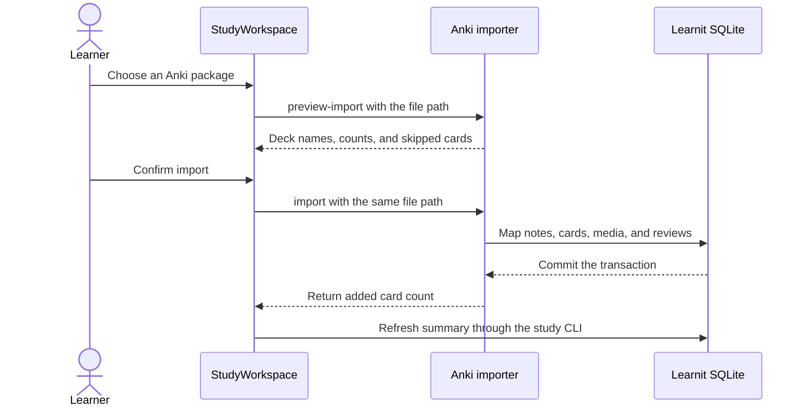

[The importer](adapters/study/anki_import.py) opens the extracted package database read-only. It recognizes legacy-compatible `collection.anki2` and `collection.anki21` packages. It maps a single front-facing template with `Expression` and `Meaning` or `Front` and `Back`, and reads `Reading` when that field exists. A package with `collection.anki21b` needs to be exported with Anki's older-version compatibility option. Preview reports unsupported or unmapped cards as skipped.

Import matches decks by name and notes by GUID, and uses the note and template ordinal to identify cards. It maps Anki queue, timing, interval, and ease values into Learnit's schedule, copies referenced media, and associates review records with the resulting local card IDs. Reimporting a package avoids duplicating existing cards and reviews and preserves existing local note content and card schedules. Changes made in Learnit use its local collection. Anki interchange happens through explicit package import and export.

## Collection data and presentation

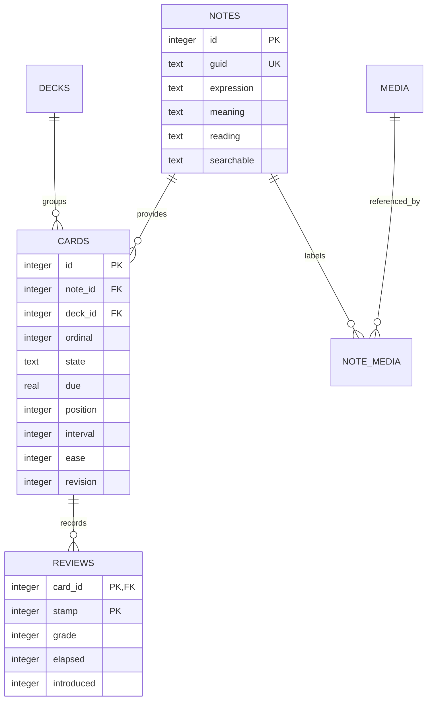

[Collection](adapters/study/collection.py) creates and opens `~/Library/Application Support/Learnit Study/Collection.sqlite3`. Notes hold the display fields and a normalized search field. Cards hold deck placement and scheduling state, with a revision used to reject stale edits or ratings. Reviews log each rating and its interval, ease, timestamp, and elapsed time. Media bytes live in SQLite and can be shared across note attachments. The adjacent `Playback/` directory contains derived audio files for AVFoundation playback. A separate `preferences` table stores the daily new-card limit and answer audio preference.

[Rendering](adapters/study/rendering.py) produces plain text for editing and search plus sanitized HTML for display. It renders bracketed readings as ruby annotations and resolves supported images from stored media. The Swift study views display HTML with WebKit, with page scripting disabled and content loading restricted. Dictionary words are also decoded into native hover links. The database file is the backup unit.

## Review a deck

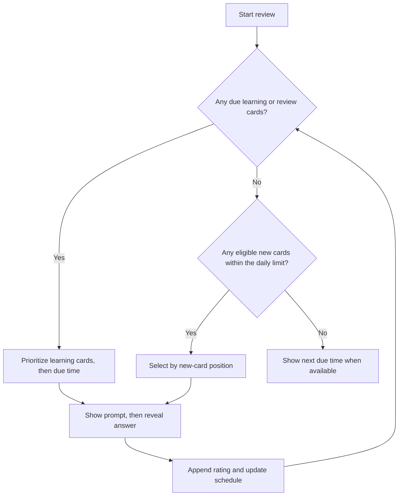

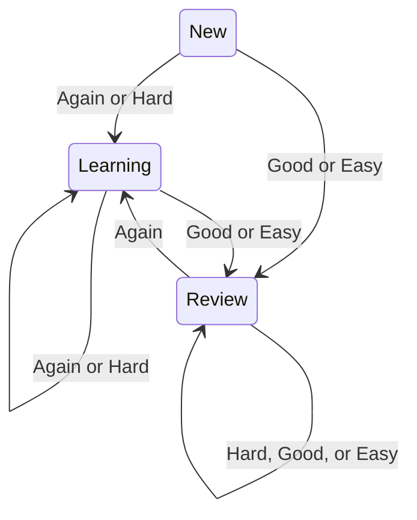

`StudyReviewPage` requests one card at a time for a selected deck or all decks. It renders the prompt first, then reveals the reading, meaning, dictionary links, and stored audio. Space reveals the answer and keys 1 through 4 submit a rating. Imported suspended cards stay out of the review queue.

`Collection.grade` checks the revision and eligibility, appends the review event, and updates card state and due time inside one transaction. **Again** schedules a one-minute retry. **Hard** schedules a six-minute retry for a new or learning card. Day-based intervals use the stored interval and ease according to the local scheduler's rules. Study days roll over at 04:00 local time. Today, Decks, and Progress read aggregate counts from the same collection.

## Search and edit cards

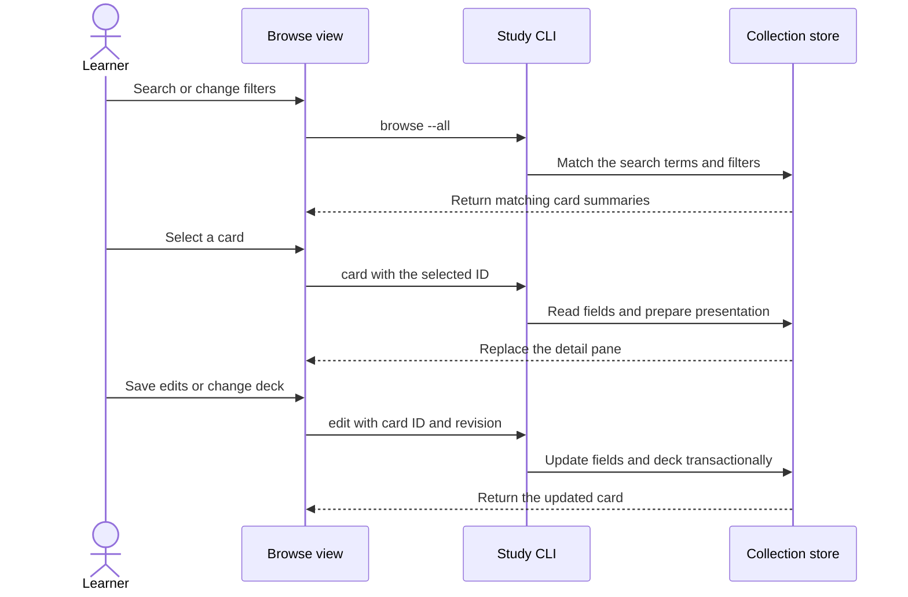

Browse asks for all matching summaries after a short input debounce. `Collection.browse` uses case-folded substring matching over plain-text renditions of the expression, meaning, and reading. Each search term must match. Deck and **Unbracketed readings** filters are evaluated in the same query. The terminal CLI also supports paginated results.

The selected card loads separately from the result list, so the list can stay in place while the details are fetched. Swift discards responses for superseded selections. When a card is edited, Python updates its searchable text and increments the revisions of cards sharing its note. Moving the card changes its deck assignment and leaves its review record attached to the same card ID.

## Maintain the study collection

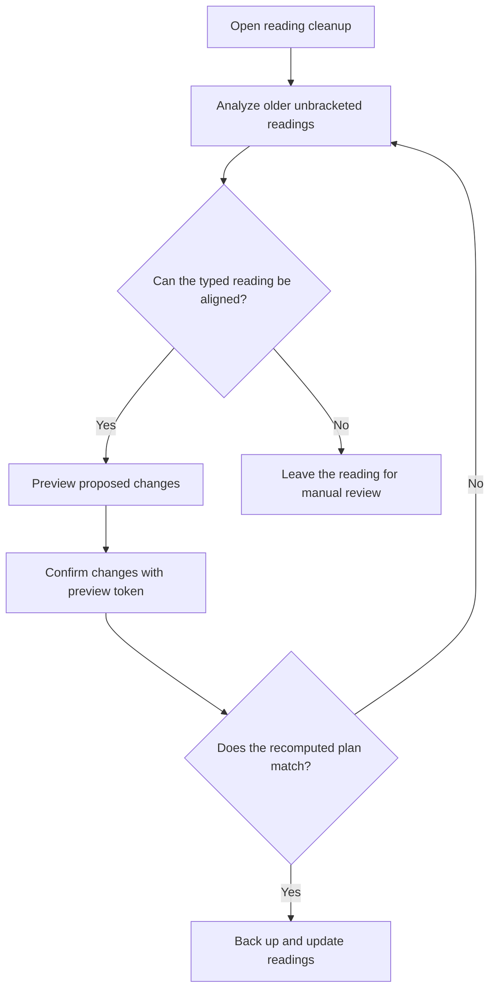

- **Reading cleanup** proposes bracketed readings from unbracketed kana already stored with eligible kanji passages. [Reading cleanup](adapters/study/reading_cleanup.py) uses MeCab spans to align the user's reading and leaves uncertain alignments for manual review. Already annotated readings and kana-only passages are kept as they are. Applying the preview recomputes its token under a write transaction, saves a SQLite backup, and changes the readings, search text, and associated card revisions. Scheduling fields and review history remain in place.
- **Backup and restore** uses SQLite's backup API. Backup writes a temporary database before replacing the destination file. Restore reads the selected backup, checks schema compatibility, database integrity, and foreign keys, then copies its contents into the active collection after user confirmation. Cards, reviews, media bytes, and preferences are part of the snapshot.
- **Study preferences** update the new-card limit and whether to play audio on answer reveal. The UI refreshes its summary after collection changes.

## Recognition evaluation

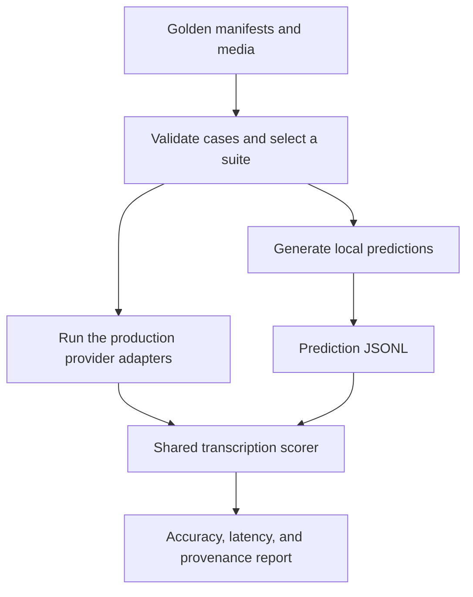

[Golden fixtures](data/golden/ja) cover both short smoke cases and longer speech or handwriting passages. [The evaluation runner](evals/transcription.py) validates the manifests and media and runs the same Google Vision and OpenAI speech adapters used by the CLI, or scores predictions supplied as JSONL. [The local prediction runner](evals/local_predictions.py) can produce those predictions with whisper.cpp or Tesseract. Both scoring paths use the same Unicode normalization, character error rate, exact-match, and latency reporting. Evaluation artifacts go to user-selected outputs and sit outside the study collection.

Regression tests cover the boundaries where user workflows meet the implementation. [Card-intake tests](tests/unit/test_card_intake.py) exercise recognition and standard generation. [Passage export tests](tests/unit/test_passage_deck.py) check the Anki note schema. [Collection tests](tests/unit/test_study_collection.py) cover importing, saving, reviewing, searching, backup, and reading cleanup. [macOS tests](learnit-deck/learnit-deckTests) and [UI tests](learnit-deck/learnit-deckUITests) cover native features and screen-level flows. The [evaluation guide](evals/README.md) lists the benchmark commands separately.

## Server-side code in the repository

The [FastAPI service](infrastructure/api/main.py) exposes standard card and deck generation through the same Python container and use cases. Its deck endpoint uses FastAPI background tasks. The repository also contains a separate [Celery worker module](infrastructure/jobs/celery_app.py), [SQLAlchemy models and repositories](infrastructure/database), and a [Docker Compose setup](docker-compose.yml) with Redis and PostgreSQL. These files describe a server-side deployment surface. The macOS study and export workflows run through local Python subprocesses and the SQLite collection described above.
