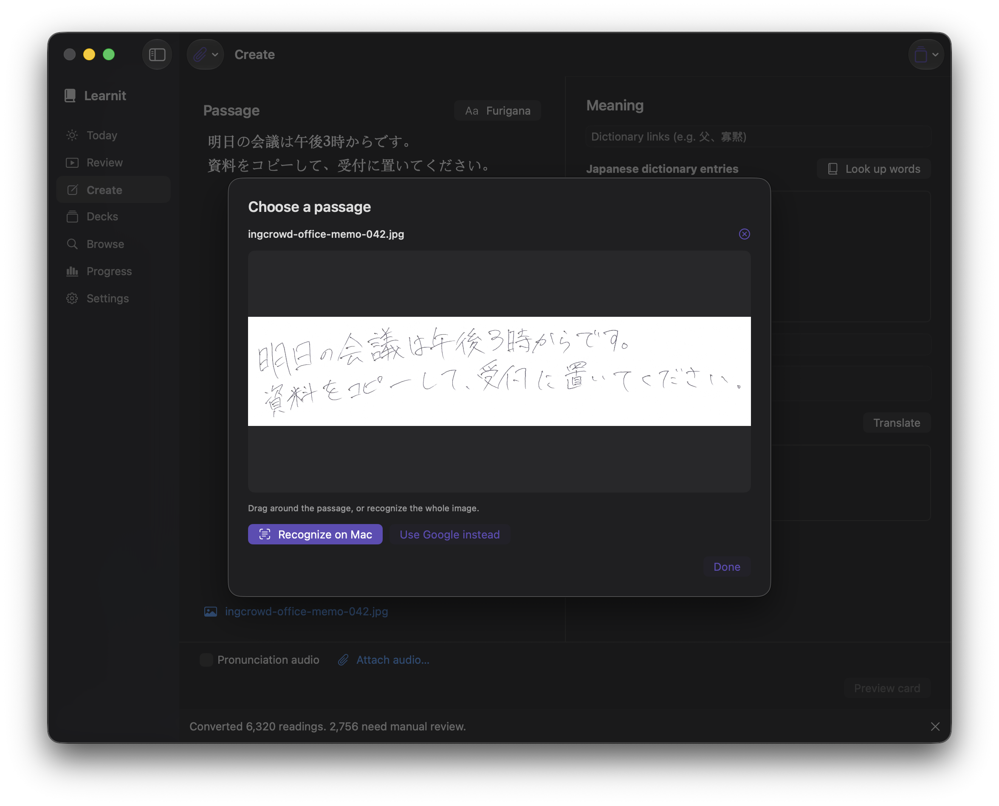
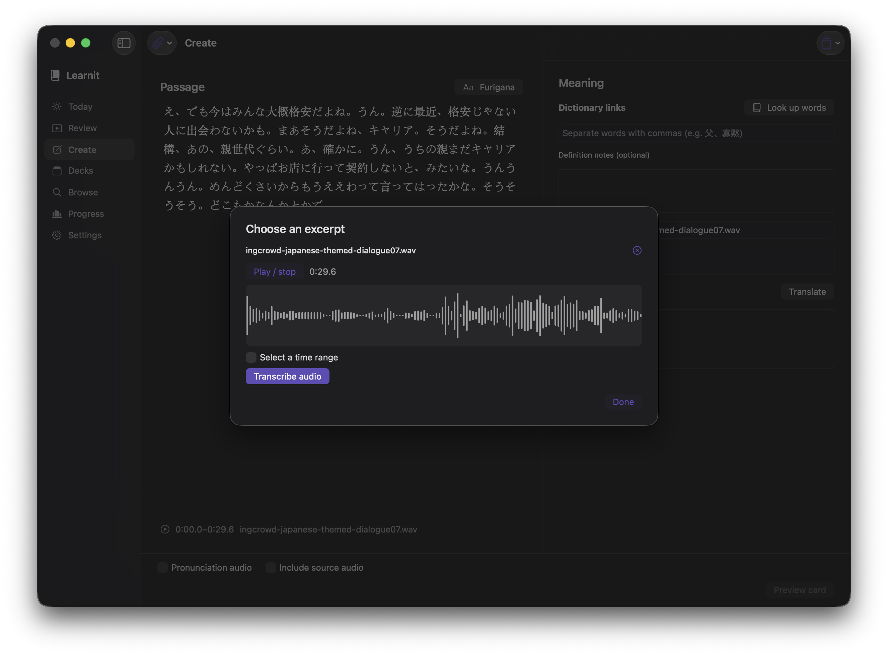
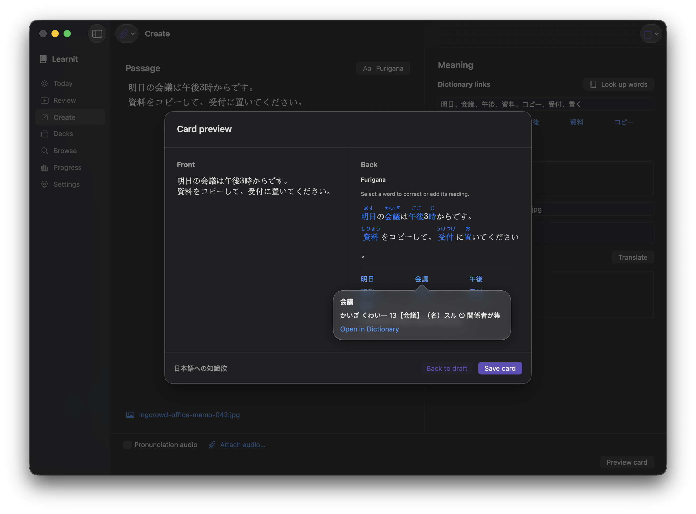

# Learnit Anki

- [Japanese cards from text, images, and audio](docs/japanese_card_intake.md)
- [Japanese transcription evaluation](evals/README.md)
- [Quick start](docs/quick_start_guide.md)

## Text OCR

Lets you add handwritten Japanese text via images, whether from the internet or your phone.

Supports local Apple foundation model as well as Google's OCR API.

## Speech to Text

Lets you add audio clips from native speakers, whether from the internet or recorded on your phone.

## Dictionary Integrations

Integrates with in-line dictionary definitions directly from your Mac's dictionary.

> Note: you will need to turn on the Japanese-Japanese or Japanese-English dictionary in your Dictionary app settings.

## Architecture

See [ARCHITECTURE.md](ARCHITECTURE.md) for more on how its built.
