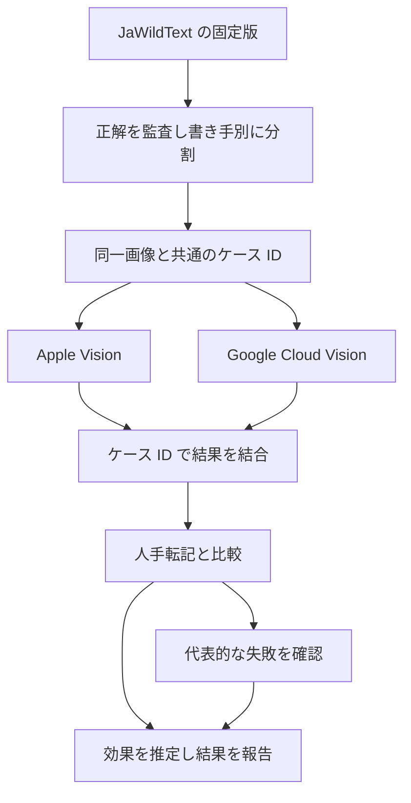

# 日本語手書き OCR の比較実験計画

## 研究目的

撮影した日本語の手書き資料から Anki カードを作るとき、macOS の Apple Vision と Google Cloud Vision のどちらが、修正の少ない下書きを作れるかを調べる。実際の Learnit が使う認識処理を呼び出し、認識精度、失敗率、待ち時間、手修正の負担を比較する。結果をもとに、端末内 OCR を初期設定として維持するか、撮影・前処理を改善するか、条件に応じて Google での再認識を案内するかを決める。

主実験では、同一のページ画像を両方に入力し、人手転記に対するページごとの結果を対応づける。追加実験を行う場合は、開発用データで選んだ前処理、または再認識条件を一つだけ固定し、評価用データで検証する。

## データと分割

Hugging Face の **JaWildText** の `handwriting_ocr` 構成をコミット `627ca7ea7c224ffe1accff8737991fc2240784fa` に固定する。論文によると、日本語母語話者51人が書いた現代の手書き画像1,065枚に6,002行の転記がある。罫線あり・なしの紙、タブレット、ホワイトボードを含み、横書きと縦書きがある。書き手は生成された文章を書き写し、転記者は書き損じも含めて画像内の文字を記録した。画像と注釈は Apache 2.0。自由記述のノートへの一般化と、各ベンダーの既存学習データとの重複は、この実験からは判断できない。 [論文 §3.3–3.5](https://arxiv.org/html/2603.27942v2#S3.SS3) · [固定リビジョン](https://huggingface.co/datasets/llm-jp/jawildtext/tree/627ca7ea7c224ffe1accff8737991fc2240784fa) · [ライセンス](https://huggingface.co/datasets/llm-jp/jawildtext#license)

| データ | 規模 | 使い方 |
|---|---:|---|
| 既存の Learnit データ | 手書き16例 | 動作確認と既知の失敗の再現に使う。既出の JaWildText の書き手は開発側に入れる。 |
| JaWildText 開発用 | 約200枚 | うち100枚をパイロットに使う。縦横書きと媒体をカバーし、入力、正解、接続、ばらつきを確認する。必要なら追加実験を一つ選ぶ。 |
| JaWildText 最終評価用 | 約800枚 | 開発と書き手が重ならないように分け、両エンジンの出力を見る前に固定する。 |

JaWildText の対象は合計1,000枚まで。書き手ごとのまとまりを優先し、実際の枚数と人数を報告する。既存の歴史資料は別枠のストレステストに使う。

### 他の候補

| 候補 | 比較に使える範囲 |
|---|---|
| Nexdata | 現代日本語のスマホ撮影画像5,147枚と行単位の座標・転記があり、条件の近い外部検証候補。利用の際は契約上のクラウド送信・結果公開の条件を確認する。 [提供元](https://nexdata.jp/datasets/ocr/1296) |
| IngCrowd | 公開時点で55人が同じ業務メモを書き写したデータ。筆跡による差の検証に使える。文章やレイアウトの多様性は限られる。 [提供元](https://www.ingcrowd.jp/hugging-face-japanese-handwriting-dataset/) |
| Honkoku-Lines | 100万行以上のくずし字の行画像。歴史資料を対象とする追加実験の候補。 [データカード](https://huggingface.co/datasets/yuta1984/honkoku-lines) |

実際の利用に近い外部検証を行うなら、本人の許諾を得た現代のノートや手紙を別枠で集める。公開ベンチマークと分けて結果を示す。

### 正解の作成と固定

1. 固定した `handwriting_ocr` の Parquet シャードから画像 ID、書き手 ID、媒体、行ごとの文字列とポリゴンを取得する。配布上の分割名は `train`。最初の N 件を取るのではなく、全シャードのメタデータを確認して選ぶ。元の行データはローカルに保持する。 [データ項目](https://huggingface.co/datasets/llm-jp/jawildtext#data-fields)
2. 画像の SHA-256、デコード後の画素の SHA-256、画像 ID で重複を調べる。近似重複と酷似した転記も確認し、同じ文書の別撮影は同じ分割グループに置く。書き手が不明なページは、書き手を分けた本評価から外す。
3. 既出の書き手 `2, 3, 4, 7, 28, 35, 46` を開発用に入れる。残りは固定シード `20261128` で書き手単位に割り付ける。縦横書きと媒体の分布が適格データ全体に近づくようにし、媒体が不明な場合は不明として数える。除外理由と集計を出力取得前に記録する。 [既存データ](../../data/golden/ja/handwriting/cases.jsonl)
4. 正解の初期値は固定した上流コードの読み順で作る。行ポリゴンの過半数が縦長なら縦書きと判定し、中心座標で縦書きは右から左、横書きは上から下へ並べる。方向ラベルと画像が食い違う例、欄外文字、混在レイアウトを抽出し、OCR の出力を見ずに日本語を読める人が判定する。該当例すべてと、それ以外の層別サンプルを画像と照合する。元の行順、修正理由、曖昧さを記録し、行境界を保持する。書きかけの文字を表す `□` は主集計に含め、そのページを除いた集計も出す。 [固定した参照生成コード](https://github.com/llm-jp/llm-jp-eval-mm/blob/677ebdd627d9fbb3ea87693f24cc4e6d97c4a799/src/eval_mm/tasks/jawildtext_handwriting_ocr.py) · [読み順の検証](https://github.com/llm-jp/llm-jp-eval-mm/pull/238)
5. クラウド送信可能な画像を本比較に登録し、元画像と推論の生出力は Git 管理外に置く。紙面に出す画像や出力例は掲載条件を確認する。Google の同期 API は画像をメモリ上で処理し、送信内容を Cloud Vision の学習に使わないと明記している。 [Google のデータ利用](https://cloud.google.com/vision/docs/data-usage)
6. 対象 ID、データのリビジョン、画像ハッシュ、分割シード、参照生成コードの版、前処理、評価指標を固定する。正解の修正履歴は監査ログに残す。パイロットで運用上の設定を決めたら、評価設定を Git に記録する。

## 実験パイプライン

| 段階 | 成果物 | 検証 |
|---|---|---|
| 取得・分割 | `inventory.jsonl`、分割マニフェスト、正解監査ログ、前処理済み画像 | ID、画像ハッシュ、書き手、利用条件、除外理由を確認 |
| 認識 | プロバイダー別の予測 JSONL | 画像・設定のハッシュと最終ステータスを記録。途中再開時は未完了ケースのみ実行 |
| 集計 | ページ別の比較テーブル、信頼区間、層別集計 | ケースの集合、画像ハッシュ、設定が一致することを確認 |
| 分析・報告 | 誤りレビュー、図表、変更提案 | 開発と最終評価を分け、事前に決めていない層別集計は探索的と明記 |

**マニフェスト**には既存ローダーと互換性のある `id`、`media`、`reference`、`kind`、`language`、`suite`、`category`、`group`、`source_url`、`license` を持たせる。`group` は書き手または同一文書で連結したグループ、`suite` は `passages`。実験用に `source_image_id`、`source_revision`、`writer_id`、`split`、`writing_direction`、`medium`、`sha256`、`original_sha256`、`reference_has_incomplete_glyph`、`cloud_eligible` を追加する。画像パスはマニフェストのディレクトリ配下に置く。

**予測レコード**には既存形式の `id`、`prediction`、`latency_seconds`、`model` と、`provider`、`input_sha256`、`config_sha256`、`status`、`attempt_count`、最終エラー種別、タイムスタンプを入れる。最終状態は `ok`、`empty`、`provider_error`。行が存在しない場合は実行未完了として扱う。

**ファイル配置**は、実装を `evals/ocr/`、データと生出力を Git 対象外の `output/ocr-ja/<study-id>/`、計画書・論文・集計済みの図表を `docs/papers/` とする。既存の `evals/transcription.py` から文字正規化と編集距離を再利用する。現行の画像評価は Google のみで、エラーを CER の集計から除くため、両者の対応づけと失敗の集計を追加する。 [既存の評価コード](../../evals/transcription.py)

### 認識処理と計測

| 経路 | 呼び出し方法 | 記録する実行条件 |
|---|---|---|
| Apple Vision | macOS のバッチ CLI から、アプリと同じ `ImageOCR.readOnMac` を呼ぶ。端末内フレームワークの `accurate` と `ja-JP` を使う。 | Mac の機種、macOS ビルド、Vision リクエストのリビジョン、コミット、ウォームアップ |
| Google Cloud Vision | 既存の `ServiceContainer.create_image_transcriber` から `GoogleVisionTranscriber` を呼ぶ。`DOCUMENT_TEXT_DETECTION` と `ja` で同期の `images:annotate` を使う。 | エンドポイント、設定、実行日、コミット、再試行、課金対象のリクエスト数 |

Apple の CLI とアプリが既存画像で同じ結果を返すことを確認する。両方で同じバイト列のページ画像を使う。EXIF の向きは一度だけ反映し、画質とレイアウトを保ちながら Base64 の増分も含めて Google のリクエスト上限に収める。実アプリの切り抜きやアップロード用圧縮の影響を調べる場合は、別の条件として記録する。 [Apple 実装](../../learnit-deck/learnit-deck/ImageOCR.swift) · [Apple Vision API](https://developer.apple.com/documentation/vision/vnrecognizetextrequest) · [Google 実装](../../adapters/transcription/google_vision.py) · [Google 手書き OCR](https://cloud.google.com/vision/docs/handwriting) · [Google 上限](https://cloud.google.com/vision/quotas)

まず開発用の少数画像で、日本語対応、Google の認証、同一入力を確認する。認証失敗が続く場合は実行を止める。一時的な失敗だけ上限付きで再試行し、最終状態を逐次保存する。ページを1枚ずつ処理し、同じ機器・ネットワークから、準備済み画像を渡して文字列を受け取るまでを計測する。Google の通信時間を含める。ケース順を固定シードで決め、可能ならプロバイダーを交互に呼ぶ。ウォーム時の p50・p95、初回の待ち時間、タイムアウト率を分けて出す。ベースラインの Google 呼び出しは最大1,000回。予備試験が同一設定なら結果を再利用し、ウォームアップ、再試行、追加実験の呼び出しを別に数える。 [Google 料金](https://cloud.google.com/vision/pricing)

## 評価指標

| 指標 | 測り方 |
|---|---|
| **主指標 · 文字誤り率（micro CER）** | 全ページの文字挿入・削除・置換数の合計を、正解文字数の合計で割る。Unicode NFC に正規化して空白を除き、句読点・かな・漢字は維持する。空出力と最終エラーは全削除として数える。挿入が多い場合は100%を超える。 |
| **両者の差と不確実性** | `Google CER − Apple CER` をポイント差で報告する。両者の同一ページの結果を保ったまま、書き手・文書グループを単位とする対応付きブートストラップを固定シードで10,000回行い、95%信頼区間を計算する。 |
| ページ単位の失敗 | ページ別 CER の中央値・p90、完全一致率、空出力率、エラー率。重大失敗率の差と95%信頼区間も同じグループ再抽出で求める。重大失敗は空出力、最終エラー、またはページ CER が100%以上。両者が認識に成功したページだけの CER も、分母とともに示す。 |
| 誤りの内訳 | 縦横書き、媒体、文章量ごとに画像数と書き手数を添える。読み順、行落ち、文字の置換、過剰な挿入を記録し、突出した挿入が全体に与えた影響も出す。 |
| 処理時間と費用 | p50・p95、タイムアウト、試行回数、課金対象数、実効費用。再認識ルールを検証する場合は、100ページあたり何回クラウドに送るかも示す。 |
| Anki での修正負担 | 30〜50件を目安に、認識元を伏せた上で、画像を見てカードに使える文章へ直す時間、修正操作数、完了率を測る。同じ人には同一ページを二度見せず、両経路が均等に割り当てられるようにする。1人で実施した場合はその旨を書く。 |

最終評価では全ケースの対応を保ち、片方の失敗でペアを落とさない。書き手の寄与が偏る場合は、書き手を等しく重み付けした結果も示す。縦書き・横書きや媒体ごとの結果は、サンプル数が少ない場合は記述にとどめる。到達できる精度はページ数に加えて独立した書き手グループ数にも依存するので、パイロットから信頼区間の幅を見積もる。上流との再現性確認が必要なら、改行を残す NFKC 正規化と `max(0, 1 − CER)` のページ平均も併記する。 [上流の評価実装](https://github.com/llm-jp/llm-jp-eval-mm/blob/677ebdd627d9fbb3ea87693f24cc4e6d97c4a799/src/eval_mm/metrics/jawildtext_handwriting_ocr_scorer.py)

### LLM による誤り分類

正解との文字比較を主評価にする。LLM は補助的に、段落・縦書きの読み順、脱落、繰り返し、語彙の意味が変わる置換などを分類する。認識元を伏せた出力 A・B、人手転記、差分を与え、判断の根拠となる文字列を含む JSON を返させる。元画像を与える場合は、そのサービスへの共有条件も確認する。入力をデータとして扱い、ツールは無効にする。判断できない場合は `uncertain` を返させる。

50件程度の層別サンプルを人が判定し、可能なら2人で独立に見た上で不一致を解消する。人手ラベルに対する macro F1 と、出力 A・B の順番を入れ替えたときの一致率を測る。LLM の分類結果は参考値として扱い、読み順や文字が曖昧な事例は画像を見た人が判断する。

## 成功基準と設計提案

暫定基準は **CER が3ポイント改善**し、**重大失敗率の悪化が1ポイント以内**。CER の3ポイントは正解100文字あたり3編集の差。修正時間などのパイロット結果を踏まえて基準を確定し、最終評価の前に記録する。初期設定の変更を提案する場合は改善幅の95%信頼区間の下限と、重大失敗率の悪化幅の上限が基準を満たすことを確認する。

| 実測結果 | 設計に反映する候補 |
|---|---|
| Google の改善が基準を満たし、待ち時間と費用も許容範囲 | 該当入力で、ユーザーが選べる Google 再認識を見つけやすくする。 |
| 改善が縦書きなど特定条件に集中 | 認識時に取得できる情報だけを使った条件を開発用で決めて固定し、Apple 単独・Google 単独・条件付き再認識を評価用で比較する。自動送信を提案する場合は、先にユーザー設定と送信回数の上限を決める。 |
| 回転、小さい文字、読み順が主因 | 撮影ガイドまたは一つの前処理を開発用で検証し、固定したエンジン設定で最終評価を行う。 |
| 差が小さい、または信頼区間が広い | 端末内 OCR と手動での再認識を維持し、次に改善する価値がある失敗例を示す。 |

原稿と [事前試験の報告 PDF](japanese-handwriting-ocr/japanese-handwriting-ocr.pdf) は `docs/papers/japanese-handwriting-ocr/` に置く。固定した対象 ID、画像・正解のハッシュ、読み順の判断と除外理由は [実験資料](japanese-handwriting-ocr/evidence) にある。本測定の完了後は、同じ原稿に対象数と実行環境、対応差と信頼区間、層別の図表、実例、限界、設計への提案を反映する。
