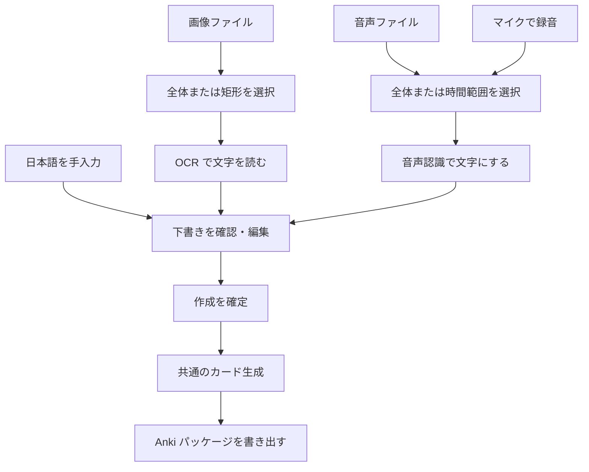
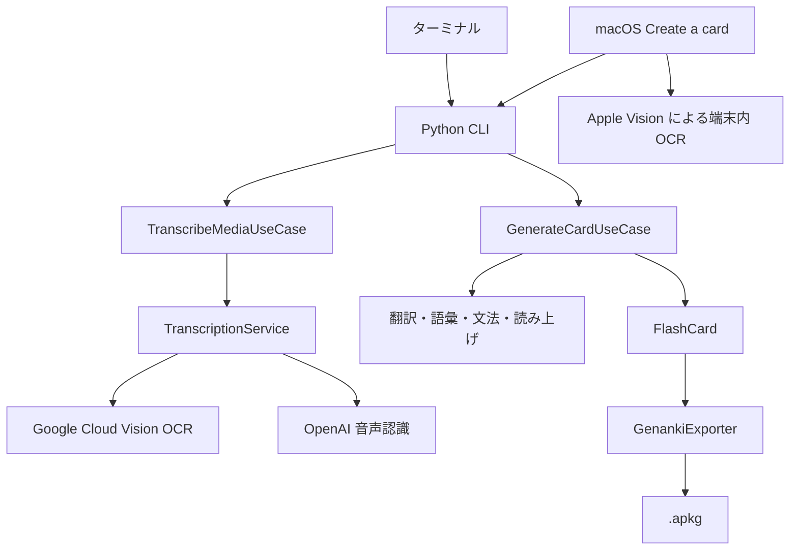
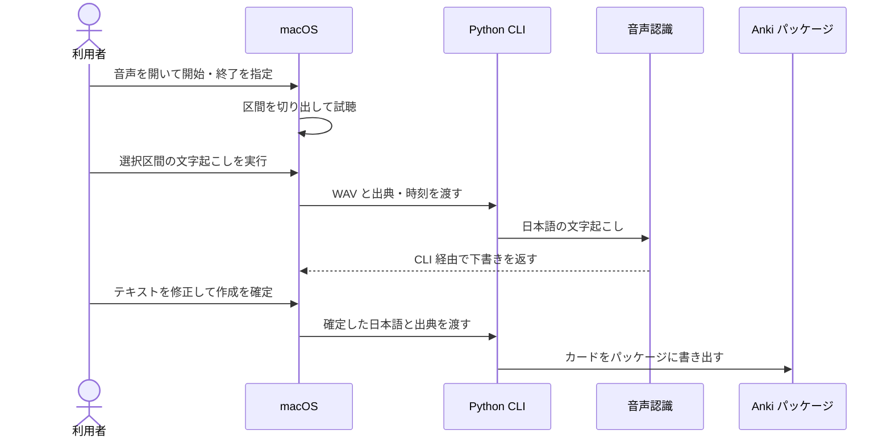
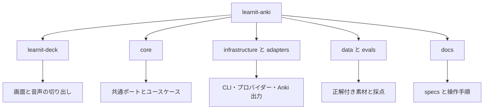
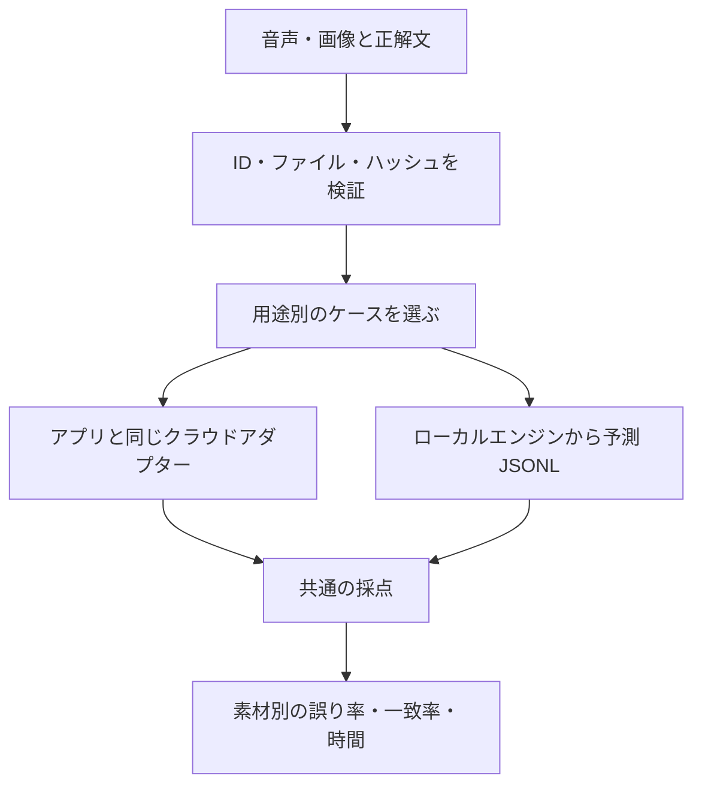

# 日本語の素材から Anki カードを作る仕様

## 目的と完了条件

日本語の文章、手書きの画像、録音、ポッドキャストを見聞きしているときに、覚えたい表現を拾って Anki に入れられるようにする。取り込み手段にかかわらず、ユーザーが確認した日本語を共通のカード生成処理へ渡す。OCR や音声認識のモデルは、カード生成や Anki の出力形式から独立して変更できるようにする。

| 利用場面 | 操作 | 確認できる結果 |
| --- | --- | --- |
| 表現をすでに知っている | 日本語を直接入力する | 入力した文章が、翻訳・語彙分析・書き出しの共通処理に届く |
| 手書きのノートや手紙から拾う | 画像を開いて、必要なら矩形を選ぶ | 選んだ画像領域の認識結果を確認・修正できる |
| ポッドキャストから拾う | 音声ファイルを開き、開始・終了秒を指定して試聴する | 選択した区間の文字起こしを確認でき、出典とタイムスタンプがカードに残る |
| その場で聞いた表現を保存する | マイクで録音し、再生して確認する | ファイル取り込みと同じ音声認識経路からカードを作れる |
| 認識の変更を検証する | 正解付きの音声・画像を同じ評価ランナーに通す | 出典ごとの誤り率、完全一致率、処理時間を再現できる |

## 入力からカードまで

### 入力と出力の契約

| 段階 | 受け取るもの | 返すもの・保存するもの |
| --- | --- | --- |
| 画像の準備 | macOS で開いた画像と任意の矩形 | 矩形があれば選択領域を切り出す。Google には PNG または JPEG を送る。Mac 上の認識には画像を直接渡す |
| 音声の準備 | 音声ファイルまたは録音と任意の時間範囲 | 範囲指定時は試聴と文字起こしに同じ区間の WAV を使う |
| メディア認識 | ファイル、言語、任意の出典ラベル | `CardDraft(text, language, source)`。CLI は JSON を標準出力に返す |
| カード生成 | 確定した文章、原文と訳の言語、音声の要否、出典 | 翻訳、語彙分析、任意の文法メモと発音音声を持つ `FlashCard` |
| 書き出し | デッキ名とカード | `output/<deck-name>.apkg`。出典は既存カードのノート欄に入る |

macOS は **Create a card** 画面を開く。手入力・画像・音声は同じ編集欄とカード設定を使う。初期設定は日本語から英語へのカードで、言語は変更できる。テキストや CSV の一括取り込みにも同じデッキ設定を使う。発音音声をオンにすると、確定した文章を読み上げる。音声選択に使った元の録音は、試聴と文字起こしの入力として扱う。

### ポートとアダプター

- 入力側は macOS と CLI。macOS は画像の切り出しや音声範囲の編集を担当し、CLI は認識・カード作成のコマンドを提供する。画像は Apple Vision を選んで Mac 上で認識することもでき、同じ下書き編集画面に表示する。
- `TranscriptionService` は画像 OCR と音声認識が実装する共通ポート。依存性注入で用途に合うアダプターを選ぶ。認識は下書きを返し、作成時は確定済みの文章を `GenerateCardUseCase` に渡す。
- 翻訳・辞書・発音・保存・エクスポートの既存ポートを活用する。翻訳や語彙分析の失敗はエラーとして表示し、発音音声を取得・保存できなかった場合は音声なしのカードを作成できる。
- ローカルで生成した認識用の一時画像と切り出し音声は処理後に削除する。範囲指定時にプロバイダーへ送るのは、選択区間の WAV。全体を選んだ場合は音声ファイル全体を入力に使う。

### 長い音声の操作

範囲は `0 ≤ 開始 < 終了 ≤ 音声の長さ`。スライダーまたは秒数欄で指定できる。作成時の出典には、最後に文字起こしが成功した範囲を添える。たとえば `episode.mp3 [0:12.5–0:19.3]`。PCM は macOS で切り出す。圧縮音声は FFmpeg が利用できる場合、16 kHz・モノラルの WAV にしてから渡す。

## リポジトリ構成

| パス | 役割 |
| --- | --- |
| [`learnit-deck/learnit-deck/ContentView.swift`](../../learnit-deck/learnit-deck/ContentView.swift) | 初回セットアップとプロジェクト設定 |
| [`learnit-deck/learnit-deck/MediaCardView.swift`](../../learnit-deck/learnit-deck/MediaCardView.swift) | 手入力・画像・録音・ファイルの取り込み、共通のカード編集と書き出し |
| [`learnit-deck/learnit-deck/AudioClip.swift`](../../learnit-deck/learnit-deck/AudioClip.swift) | 時間範囲の検証、WAV の生成、出典用の時刻表示 |
| [`infrastructure/cli/main.py`](../../infrastructure/cli/main.py) | `ocr`、`transcribe`、`add`、`batch` の入口 |
| [`infrastructure/config/`](../../infrastructure/config/) | 環境設定と認識・カード生成アダプターの組み立て |
| [`core/domain/interfaces.py`](../../core/domain/interfaces.py) | 認識と既存サービスのポート |
| [`core/use_cases/transcribe_media.py`](../../core/use_cases/transcribe_media.py) | 認識を呼び出して下書きを返す |
| [`core/use_cases/generate_card.py`](../../core/use_cases/generate_card.py) | 確定したテキストをカードにする |
| [`adapters/transcription/`](../../adapters/transcription/) | Google Cloud Vision と OpenAI の実装 |
| [`adapters/anki/genanki_exporter.py`](../../adapters/anki/genanki_exporter.py) | 出典と発音を含む Anki パッケージ |
| [`data/golden/ja/audio/`](../../data/golden/ja/audio/) | 音声・正解文・元の収録区間・出典 |
| [`data/golden/ja/handwriting/`](../../data/golden/ja/handwriting/) | 手書き画像・正解文・読み順・出典 |
| [`evals/local_predictions.py`](../../evals/local_predictions.py) | リポジトリ直下の評価スクリプト。ローカル Whisper または Tesseract の結果を JSONL にする |
| [`evals/transcription.py`](../../evals/transcription.py) | マニフェスト検証、プロバイダー実行、保存済み予測の採点 |
| [`tests/unit/test_card_intake.py`](../../tests/unit/test_card_intake.py) | 入力経路の合流と採点の回帰テスト |
| [`docs/japanese_card_intake.md`](../japanese_card_intake.md) | アプリ・CLI の操作と設定 |
| [`evals/README.md`](../../evals/README.md) | 評価コマンドと指標の定義 |

## 評価データと採点

### データの内訳

| スイート | 音声 | 手書き | 目的 |
| --- | ---: | ---: | --- |
| `passages` | 8 | 16 | 発話が続く音声と、文章・複数行の画像で評価する |
| `smoke` | 6 | 6 | 短い語句と一文字で接続・処理経路を確認する |

- 音声には、配信元の原稿付きの政府広報ポッドキャスト2件（154.2秒・183秒）、時刻付きの人手書き起こしがある台本なし会話4件、公開記事の朗読2件を収録。台本付き対話、台本なし会話、発話の重なり、朗読の結果は、カテゴリ別に読める。
- 画像には、JaWildText の5〜8行の現代手書き7件、2024年の手紙の実例1件、筆者の加筆を含む西田幾多郎の原稿1件、与謝野晶子と五島慶太の書簡2件、既存のメモと原稿5件を収録。JaWildText は実際に人が書いた画像と、目で読んで付けられた行単位の正解を使う。筆記用の文章は研究側が用意したもの。
- 各 `cases.jsonl` に ID、相対パス、正解、言語、カテゴリ、出典・使用条件を記録する。追加素材にはハッシュも付ける。同じ話者、筆者、共通の筆記課題に属するケースは同じグループに置く。音声と画像の具体的な出典は各データフォルダの README に記載する。

### 評価の仕様

1. 実行前にマニフェストを検証する。素材の欠落、空ファイル、ハッシュ不一致、重複 ID はエラーとする。
2. 本番経路を測る場合はアプリと同じアダプターを使う。ローカルで比較する場合は Whisper または Tesseract の出力を JSONL に保存し、同じ採点器に渡す。
3. 正解と予測を Unicode NFC にそろえ、空白と改行を無視する。句読点・漢字・かな・旧仮名は区別する。
4. 文字誤り率（CER）は、採点したケースの編集距離の合計を正解文字数の合計で割る。完全一致率、中央値の処理時間、処理エラー数も集計する。
5. 同じマニフェスト・同じ正規化・同じモデル設定で再実行する。発話の重なりと縦書きの列順は、文字そのものを読めても CER に影響する。モデルを比較するときはカテゴリごとの内訳を確認する。

## 動作確認と次の判定

| 確認項目 | 判定のしかた |
| --- | --- |
| 三つの入力経路が合流する | 手入力・画像・音声で同じ日本語を確定すると、同じ生成処理を通ること |
| 音声切り出し | 長い WAV と MP3 から指定した範囲だけを切り出し、出力時間が指定と一致すること |
| Anki の出力形式 | テスト用プロバイダーから書き出した `.apkg` に、日本語と出典欄が入ること |
| 評価データ | 36件の検証が通り、長文24件を独立して選べること |
| ローカル評価 | Whisper と Tesseract の予測を、同じ採点器で評価できること |
| クラウド精度 | 有効な OpenAI キーと Google Cloud Vision API が必要。設定後に長文スイートを実行して初回基準値を記録する |
| 学習時の使いやすさ | 一つの表現を選ぶところから Anki へ入れるまでを計り、手入力した場合と修正量・操作時間を比べる |

コマンド例は[評価手順](../../evals/README.md)と[取り込み手順](../japanese_card_intake.md)にある。
